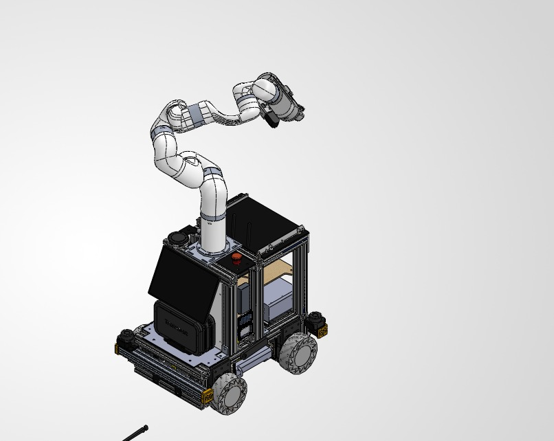

# frida-omnibase-cad
Full CAD of the FRIDA Omnibase | RoBorregos @Home



## Layout

| Path | Contents |
| --- | --- |
| `cad/OmniBaseV2/` | Current base. Top-level assembly: `OmniFrida.SLDASM` |
| `cad/v0.01/` | Earlier version of the base. Top-level assembly: `v0.01.SLDASM` |
| `cad/PilaCase/` | Battery case. Assembly: `PilaCaseEnsamble.SLDASM` |
| `cad/coverscrewpila.SLDPRT` | Part used by `OmniBaseV2/Parts/Batteries/Cajon/Assembly cajon pilas.SLDASM` |
| `FRIDA/GripperFinal/` | Gripper used by `XArm.SLDASM` and `OmniFrida.SLDASM`. Assembly: `GripperAssem.SLDASM` |
| `GripperMotorDC/` | DC motor gripper variant. Assembly: `GripperAssem.SLDASM`. `OmniFrida.SLDASM` only uses its `VLX.SLDPRT` |
| `urdf/OmniFrida_URDF/` | ROS package exported from `OmniFrida.SLDASM` |
| `urdf/OmniFrida_URDF_collision/` | Same robot with simplified meshes, for collision |
| `3d_print/` | Print files (`.3mf`) for the planetary gearbox parts |

## Cloning

CAD files and meshes are stored with [Git LFS](https://git-lfs.com). Install it **before** cloning, otherwise you get pointer files instead of the models:

```sh
git lfs install
git clone https://github.com/RoBorregos/frida-omnibase-cad.git
```

To get only the URDF packages without downloading the whole CAD:

```sh
GIT_LFS_SKIP_SMUDGE=1 git clone https://github.com/RoBorregos/frida-omnibase-cad.git
cd frida-omnibase-cad
git lfs pull --include="urdf/**"
```

## Working with the assemblies

Assemblies find their parts through relative paths, so keep `cad/`, `FRIDA/` and `GripperMotorDC/` side by side and their contents where they are. To move or rename a part, do it from SolidWorks (for example Pack and Go) so the references get updated, not with `git mv`.

`FRIDA/GripperFinal/` and `GripperMotorDC/` share 29 file names with different content. SolidWorks can't open two files with the same name at once, so close one gripper before opening the other.

CAD files can't be merged. Coordinate with the team before editing an assembly someone else is working on.

Close SolidWorks before pulling, since it locks open files.
